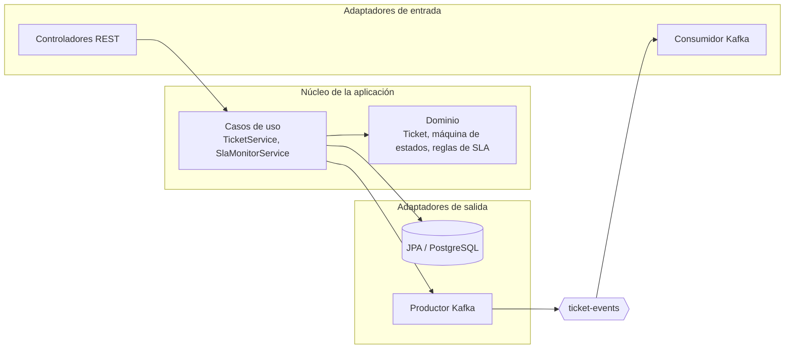
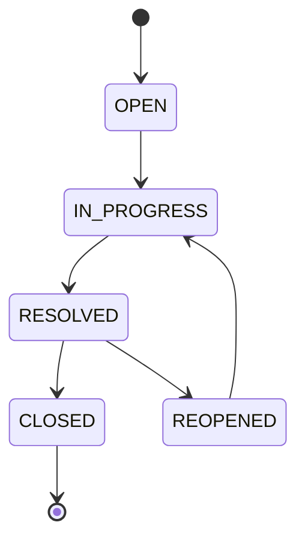

# TicketFlow

Español · [English](README.md)

Sistema de gestión de tickets de soporte construido con **arquitectura hexagonal**. Los clientes abren tickets, los agentes los trabajan y los administradores supervisan. Cada ticket recibe una fecha límite de SLA según su prioridad, una tarea programada marca los tickets vencidos y los eventos del dominio se publican en **Kafka**.

**Stack:** Java 21 · Spring Boot 4 · Spring Security + JWT · PostgreSQL · Flyway · Apache Kafka · Docker Compose · JUnit 5 + Mockito

<!-- CAPTURAS: agrega aquí las imágenes del login, la vista de cliente, la vista de agente y el diagrama ER (docs/images/) -->

## Funcionalidades

- **Ciclo de vida del ticket** con una máquina de estados validada (`OPEN → IN_PROGRESS → RESOLVED → CLOSED`, más `RESOLVED → REOPENED → IN_PROGRESS`). El dominio rechaza las transiciones inválidas.
- **Monitoreo de SLA**: una tarea programada se ejecuta cada minuto, marca los tickets que pasaron su fecha límite y publica un `SlaBreachedEvent`.
- **Asignación automática**: los tickets nuevos van al agente con menos tickets activos.
- **Acceso por roles** (cliente, agente, administrador) con autenticación **JWT** sin estado. La identidad de quien llama siempre sale del token, nunca de parámetros de la petición.
- **Historial de auditoría** de cada cambio de estado y de asignación, además de comentarios públicos e internos.
- **Eventos en streaming**: los eventos de ticket creado, cambio de estado y SLA vencido se publican en el tópico `ticket-events` de Kafka.
- **Esquema de base de datos versionado** con Flyway, incluidas las claves foráneas.
- **Cliente web sencillo** (HTML/CSS/JS puro) con inicio de sesión, registro, listas de tickets según el rol, filtros y una barra de progreso por ticket.

## Arquitectura

El dominio no depende de Spring, JPA ni Kafka. La capa de aplicación se comunica con el exterior solo mediante puertos, y los adaptadores los implementan.



```
com.example.TicketFlow
├── ticket
│   ├── domain                 # Ticket, TicketStatus, TicketPriority, comentarios, historial
│   ├── application            # TicketService, SlaMonitorService
│   ├── ports
│   │   ├── in                 # interfaces de casos de uso y comandos
│   │   └── out                # puertos de repositorio y de notificación
│   └── adapters
│       ├── in.web             # controladores REST y DTOs
│       ├── in.messaging       # consumidor Kafka
│       └── out                # persistencia JPA, adaptador de notificaciones Kafka
├── user                       # misma estructura para usuarios y roles
├── auth                       # endpoints de registro e inicio de sesión
└── security                   # filtro JWT, configuración de seguridad
```

### Máquina de estados del ticket



### SLA por prioridad

| Prioridad | SLA |
|---|---|
| URGENT | 4 horas |
| HIGH | 8 horas |
| MEDIUM | 24 horas |
| LOW | 72 horas |

### Roles

| Acción | Cliente | Agente | Admin |
|---|:---:|:---:|:---:|
| Crear tickets | ✅ | ✅ | ✅ |
| Ver tickets | solo los suyos | todos | todos |
| Cambiar el estado de un ticket | ❌ | ✅ | ✅ |
| Reasignar un ticket | ❌ | ❌ | ✅ |
| Comentarios públicos | ✅ | ✅ | ✅ |
| Notas internas | ❌ | ✅ | ✅ |
| Gestionar usuarios | ❌ | ❌ | ✅ |

Las cuentas nuevas registradas desde la API o el cliente web siempre reciben el rol de cliente.

### Eventos de Kafka

| Evento | Se publica cuando |
|---|---|
| `TicketCreatedEvent` | se crea un ticket |
| `TicketStatusChangedEvent` | un ticket cambia de estado |
| `SlaBreachedEvent` | la tarea programada encuentra un ticket que pasó su fecha límite de SLA |

Todos los eventos van al tópico `ticket-events`. Un consumidor de ejemplo dentro de la aplicación los registra en el log.

### Decisiones de diseño

- **Referencias por id.** Las referencias entre módulos (`created_by_id`, `assigned_to_id`, ...) son ids simples en el dominio, lo que mantiene desacoplados los módulos `ticket` y `user`. La integridad referencial la garantiza la base de datos con claves foráneas definidas en la migración de Flyway.
- **Flyway gestiona el esquema.** Hibernate solo lo valida (`ddl-auto=validate`), así que la base de datos se puede reproducir desde el repositorio.
- **Autorización en el borde.** Las reglas por rol viven en la configuración de seguridad y en los controladores (adaptadores), no en el dominio.

## Primeros pasos

### Requisitos

- Java 21
- Docker y Docker Compose

### 1. Levantar PostgreSQL y Kafka

```bash
docker compose up -d
```

> Si tienes un servicio local de PostgreSQL escuchando en el puerto 5432, detenlo antes; de lo contrario, la aplicación se conecta a ese en lugar del contenedor.

### 2. Ejecutar la aplicación

```bash
./mvnw spring-boot:run        # Windows: .\mvnw.cmd spring-boot:run
```

Flyway crea el esquema al arrancar. La API queda disponible en `http://localhost:8080` y la interfaz de Swagger en `http://localhost:8080/swagger-ui.html`.

### 3. Cargar los datos de demo (opcional)

```bash
# Linux / macOS / Git Bash
docker exec -i ticketflow-postgres psql -U postgres -d ticketflow < scripts/demo-data.sql

# PowerShell
Get-Content scripts\demo-data.sql | docker exec -i ticketflow-postgres psql -U postgres -d ticketflow
```

Ejecútalo una sola vez, sobre una base vacía. Crea cinco usuarios y ocho tickets en todos los estados, incluido uno que ya pasó su fecha límite de SLA (la tarea programada lo marca en menos de un minuto).

| Usuario | Rol | Contraseña |
|---|---|---|
| `admin1` | Admin | `Demo1234` |
| `agent1`, `agent2` | Agente | `Demo1234` |
| `marco`, `lucia` | Cliente | `Demo1234` |

### 4. Abrir el cliente web

Sirve la carpeta `frontend` con cualquier servidor estático y ábrela en el navegador, por ejemplo:

```bash
cd frontend
python -m http.server 5500    # luego abre http://localhost:5500
```

### Configuración

Los valores por defecto están pensados para desarrollo local y se pueden sobrescribir con variables de entorno:

| Variable | Valor por defecto | Para qué sirve |
|---|---|---|
| `DB_URL` | `jdbc:postgresql://localhost:5432/ticketflow` | URL de la base de datos |
| `DB_USERNAME` | `postgres` | usuario de la base de datos |
| `DB_PASSWORD` | `123456` | contraseña de la base de datos |
| `JWT_SECRET_KEY` | clave de desarrollo | clave de firma del JWT (usa un valor largo y aleatorio fuera del desarrollo local) |
| `JWT_EXPIRATION` | `86400000` | duración del token en milisegundos |

## Resumen de la API

| Método | Endpoint | Descripción | Acceso |
|---|---|---|---|
| POST | `/api/auth/register` | crea una cuenta de cliente y devuelve un token | público |
| POST | `/api/auth/login` | inicia sesión y devuelve un token | público |
| POST | `/api/tickets` | crea un ticket | autenticado |
| GET | `/api/tickets` | lista tickets (los clientes solo ven los suyos) | autenticado |
| GET | `/api/tickets/{id}` | obtiene un ticket | dueño, agente, admin |
| PATCH | `/api/tickets/{id}/status` | cambia el estado | agente, admin |
| PATCH | `/api/tickets/{id}/assign` | reasigna a un agente | admin |
| POST | `/api/tickets/{id}/comments` | agrega un comentario (notas internas: agente, admin) | dueño, agente, admin |
| GET | `/api/tickets/{id}/comments` | lista comentarios (los clientes no ven las notas internas) | dueño, agente, admin |
| GET | `/api/tickets/{id}/history` | historial de auditoría | dueño, agente, admin |
| * | `/api/users/**` | gestión de usuarios | admin |

Envía el token como `Authorization: Bearer <token>`. El contrato completo está en la interfaz de Swagger.

## Tests

```bash
./mvnw clean test             # Windows: .\mvnw.cmd clean test
```

Los tests de integración levantan el contexto real de la aplicación, por lo que los contenedores de Docker deben estar corriendo.

| Nivel | Tests | Qué cubren |
|---|:---:|---|
| Dominio | 21 | creación, fechas límite de SLA, transiciones de estado válidas e inválidas, asignación |
| Aplicación (Mockito) | 8 | creación de tickets, asignación automática, cambios de estado, casos de error |
| Integración (MockMvc) | 7 | registro, login, creación de tickets, cambio de estado, reglas por rol, propiedad de los tickets, comentarios internos ocultos |
| Contexto | 1 | la aplicación arranca |

## Mejoras futuras

- Vista de detalle del ticket en el cliente web (comentarios e historial) y acción de reasignar para administradores.
- Mostrar el nombre de los agentes en lugar de sus ids.
- Cierre de sesión automático y *refresh tokens* cuando el JWT expira.
- Tests del scheduler de SLA y del consumidor de Kafka con Testcontainers.
- Docker Compose completo que también ejecute el backend y el cliente web.
- Columnas `timestamptz` y restricciones `CHECK` para estados y roles.
- Canales de notificación reales (correo) como consumidores adicionales de Kafka.

## Autor

**Favian Ramos Garay**: [github.com/FavianRamos](https://github.com/FavianRamos)
